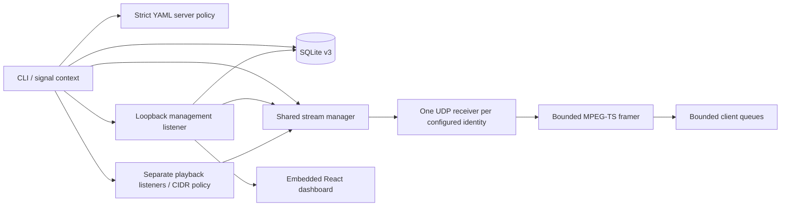
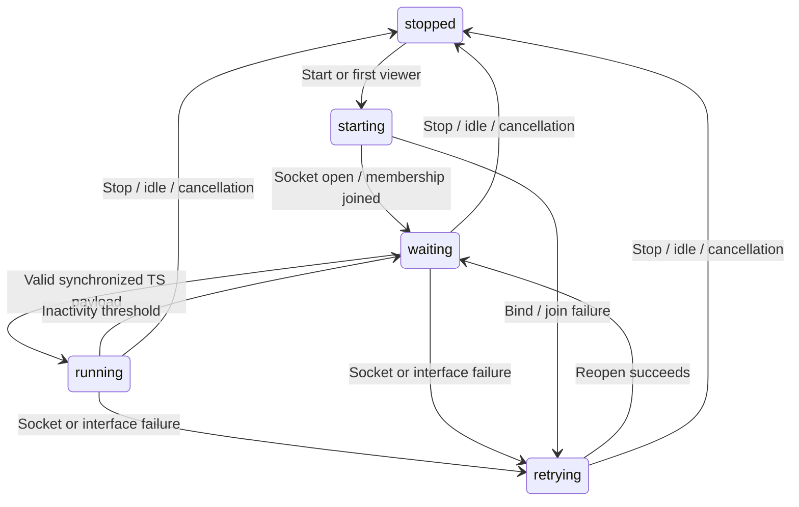

# Architecture

## Phase 3 operations layer

The repository audit in PHASE3_AUDIT.md was completed before implementation. The streaming engine is retained. Additive snapshots expose worker start time, client duration/delivered bytes/lifetime bitrate, receiver count and safe client disconnect. Existing routes remain compatible; hash navigation requires no server fallback that could intercept API or playback paths.

`internal/operations` depends on typed config, network discovery and the stream manager, with narrow repository interfaces. It does not import storage. `internal/storage` implements those interfaces. Schema v3 adds singleton revisioned server settings and bounded operational events, preserving v1 settings/v2 channels. Conditional revision updates prevent lost saves; settings rollback checks revisions under the same operations lock. JSON durations round-trip as strings.

Settings separate desired from active and last accepted startup state. General/logging fields apply live; network/streaming/timeouts are staged. Validation checks current channels, listener collisions, literal ranges/interfaces and practical bind probes. Startup rechecks channel count and actual sockets; bad staged binds restore accepted settings. If even accepted playback cannot bind, local management remains running with playback disabled and explicit listener failure metadata. Management bind/port and storage location cannot be changed by the API. Recovery mode ignores persisted settings without deleting the DB. Rollback intentionally restores the complete last accepted startup snapshot, including UI/logging fields changed since then. There is no generic process-control or host-network mutation API.

The monitor samples every 3 seconds. It retains 240 aggregate samples and 120 samples per currently configured channel, removing obsolete keys. Go runtime metrics are real; Linux getrusage deltas and /proc resident pages provide CPU/RSS. Other systems report null. CPU percent uses 100% per core. No metric history is written to SQLite. Summaries distinguish running/stopped/unhealthy/waiting and include measured continuity/discontinuity indicators, not invented packet loss.

The slog wrapper redacts recognized sensitive keys, query/user info in URLs and bearer/assignment patterns before JSON output or capture. A bounded 256-entry queue avoids blocking receiver state locks on SQLite writes. One worker inserts/prunes events with deadlines; count/age limits and capped queries bound retention. Drop counts expose overload/storage failures. Shutdown drains best-effort for two seconds, then cancels pending writes. This is filtered operational history, not a guaranteed immutable audit ledger; full journald access/file logging remain unavailable.

All new APIs inherit loopback peer/Host/Origin/Referer checks. Mutations additionally require the random CSRF token, strict 1 MiB JSON, exact content type, confirmation for settings and rate limits (60 writes/minute). No remote accounts/session/authentication boundary is invented; remote binding is prohibited. Forwarded headers are ignored by default. Opt-in same-host proxy mode requires configured loopback TCP peers, complete single-hop forwarded headers, and an exact configured external origin. Nginx enforces remote authentication and client IP authorization for every route; see deploy/NGINX.md. Diagnostic exports use the same management authorization and sanitized stored events, never private config or raw request credentials.

The React shell uses hash routes, reusable fields/dialogs/toasts/status/empty/error/skeleton components, a native SVG historical chart and shared typed API/polling logic. Native charting avoids another framework dependency. Polling has cancellation, overlap prevention, pause/manual refresh and stale markers. Forms preserve drafts on rejection and defer success until confirmed. The old UI remains as an older-daemon fallback and regression target. Browser MPEG-TS capability is inspected, but external-player copying is the supported unvalidated-preview fallback. No screenshots or visual QA are claimed without an actual rendered browser capture.

## Components and boundaries

Phase 1 CLI, network discovery, storage/settings, JSON logging and embedded UI remain. `internal/stream` has no HTTP or UI dependency. `internal/config` and `internal/storage` use the engine's typed Channel model; the engine accepts a narrow repository interface and never imports either package. `internal/cli` composes everything and owns all listener lifetimes.

## Configuration and storage

YAML/environment bootstrap remains authoritative until the first Phase 3 settings save. Persisted server settings then provide the writable subset; management binding, database location and seeds remain bootstrap-only. Channel definitions become SQLite-authoritative after a one-time YAML seed. Additive schema v2 creates `channels(id, configuration, updated_at)` with JSON validity checks while preserving schema v1 settings and the startup snapshot. Seed import and its marker commit atomically. Deletes are not resurrected on restart. Parameterized INSERT/UPDATE/DELETE operations persist a definition before runtime replacement, so a failed write preserves the running channel. Unsupported future schemas are rejected.

Channel configuration includes ID/name, multicast/unicast type, literal address, UDP destination port, explicit interface selection, enabled state, idle retention, caps, buffer requests and startup policy. Bounds and allowlists are enforced in the engine as well as YAML validation. Management creates/updates also resolve actual host interfaces. A stored interface that later disappears produces retrying state; policy-invalid stored channels remain visible in error state without opening sockets. Duplicate normalized sources, or unicast bind collisions, are rejected.

Database files use 0600; newly created state directories use 0700. Direct database symlinks are rejected. Parent directories must be trusted. The service uses a dedicated system account and writable state directory. Backup before schema migration; older binaries reject newer schemas. There is no YAML rewrite or hot reload.

## Concurrency, lifecycle and bounds

The manager has an operations mutex serializing configuration and start/stop/restart/subscribe operations, plus a state mutex protecting entries, clients, counters and budgets. HTTP/network I/O never occurs while holding the state mutex. Interface discovery and identity checks during configuration are short local OS calls; normal packet delivery does not perform discovery under that mutex.

Each accepted channel owns at most one receiver worker. All HTTP subscriptions share it, including across playback listeners. Duplicate channel aliases for the same upstream are deliberately rejected, rather than creating duplicate memberships. A resolved socket reservation is acquired before opening, so interface/address changes cannot create duplicate memberships or unicast binds. Reservations are released after closure. An idle worker marks itself retiring under the state mutex; a new viewer/start waits for that worker to release its socket before replacement. The worker context derives from the service context. Stop cancels and joins the worker before restart/replacement can rebind. Manager Close cancels all workers and joins them. No receiver is created per HTTP viewer.

State transitions:

Disabled definitions cannot start. Invalid persisted policy produces `error` without reception. `waiting` is an observed lack of valid TS packets, not an inferred UDP connection failure. Inactivity leaves the socket open. Socket failures close membership/resources before bounded exponential retry (250ms..30s); stable reception resets backoff. Interface identity/assigned IPv4/up/multicast support is rechecked about once a second. On-demand idle retention applies even while retries are pending. Always-start and manually pinned receivers keep running with no viewers. Runtime Stop blocks on-demand restart until Start/Restart; persistent `enabled`/`startup` govern the next process start.

Each subscription owns a nonblocking queue capped at 64 immutable chunks and its configured byte backlog. Per-stream and global queued-byte caps provide additional bounds. A publisher never waits on a viewer: overflow terminates that subscription and records an event/counter. Closed queues are drained to release references. Closing HTTP handlers keep their client-cap slot until handler cleanup, preventing repeated slow connections from bypassing the cap. A handler can hold one in-flight chunk (at most about one UDP payload) outside queue accounting; Go/net/http and kernel socket buffers are additional bounded overhead, not included in the queue budget.

PID history is bounded by the 8192 possible PIDs, using lazy records; pending resynchronization data is capped at two packets, with at most a datagram plus that prefix during parsing. Error history is capped at 20 entries of 1024 bytes. Channel/client counts and retry delays are bounded. No unbounded playback history is retained.

## UDP and MPEG-TS

Unicast binds to the selected local interface address and destination port. It accepts only the configured allowlisted sender IPv4; other sources increment rejected-datagram counts and never enter the framer. Loopback reception is explicitly opt-in for fixtures/local operation.

Multicast uses Go's UDP multicast listener (reuse/membership setup) and `golang.org/x/net/ipv4` for ancillary destination/interface metadata and explicit membership leave. Both ingress interface index and destination group are checked, preventing cross-delivery between groups sharing a port. Joins require an up, multicast-capable IPv4 interface. Closing also releases kernel membership. The OS may clamp the requested receive buffer; no sysctls are changed.

Read deadlines are 500ms, allowing cancellation without a permanent blocking read or an extra goroutine per datagram. Receivers check interface state and inactivity between reads. Socket/interface errors are structured events with actionable source/interface context. The engine does not call UDP connected/disconnected based on packet arrival.

The framer searches for three sync bytes 188 bytes apart, buffers split datagrams, emits whole packets unchanged, and drops invalid adaptation headers/garbage. TEI-marked packets are counted but retained. Payload continuity counters, explicit adaptation discontinuities and identical duplicates are monitored per PID; null PID continuity is ignored. No timestamp/codec rewriting occurs. Packet-loss counts are not invented from ambiguous CC gaps; continuity errors and discarded bytes are reported separately. PSI CRC/PES/codec decoding, RTP and FEC are out of scope.

Counters measure accepted UDP payload bytes/datagrams, forwarded TS packets, corrupt observations, discarded bytes, CC errors, explicit discontinuities, duplicates, retries, rejected sources, slow viewers, and payload bytes accepted by HTTP writes. Rates average counter deltas between samples; they are not NIC-level or player-acknowledged throughput. Counters reset on process/channel configuration replacement, not normal Start/Stop/Restart. Uptime resets for each receiver worker lifetime.

## HTTP and local administration

Management stays loopback-only, validating direct peer, Host/port, Origin/Referer and browser cross-site metadata. In opt-in proxy mode, only configured TCP peers may supply single-valued X-Forwarded-Host/Proto/For (optional matching Port); the exact external origin must be configured. The original peer is never replaced by a forwarded IP for authorization. Direct local requests retain local Host/origin requirements. GET/HEAD remain available for status/discovery; channel mutations additionally require strict bounded JSON plus a cryptographically random per-process CSRF header token. Native remote auth/password/session support remains unavailable; the configured proxy must enforce Basic authentication and client IP restrictions. Local processes able to reach loopback are trusted administrators. Origin/token failures are denied before reaching storage or the engine.

Playback is served only on independent listeners with their own actual-peer CIDR allowlist; empty means deny all. Only configured channels can be selected. `/udp/{group}:{port}` selects a unique enabled registered multicast channel, not an arbitrary network target. Unicast is selected by `/live/{id}.ts`. Management routes never appear on playback listeners. Legacy Windows URL compatibility is unverified.

Playback waits for a valid TS chunk before sending 200/video/mp2t. Startup timeout returns 503 without a misleading successful empty stream. Subsequent writes have per-write deadlines and immediate flushes; the server has no absolute lifetime WriteTimeout. Request cancellation closes the subscription. Service cancellation interrupts reads/handlers, shuts down every listener with bounded grace, forces connection closure on expiry, then closes the manager and SQLite. Structured server errors use slog JSON.

## Frontend and packaging

The existing React navigation/layout/theme/interface views remain. Streaming.tsx adds measured snapshots, clients, counters/errors, channel forms, lifecycle actions, and actual URL copying. Fetches have deadlines, polling does not overlap, unmount aborts reads, and failures visibly mark stale data. Channel mutations fetch a current token and report backend validation errors. Phase 3 adds validated, revision-checked server settings; management binding/storage paths and unsupported security policies remain read-only. No fabricated stream/resource data is used.

Vite output is embedded by Go; frontend builds must finish before Go checks/builds read those assets. Production needs no Node/CDN. systemd keeps least privilege and separate local management/playback policies. dpkg preserves config; schema migrations preserve state. CI includes native Linux tests, race tests, architecture builds, multicast tests where interfaces permit, synthetic four-viewer/two-listener acceptance testing, persistence/restart/SIGTERM checks and package lifecycle checks. These definitions are not evidence they have run: see PHASE2_REPORT.md and LINUX_TESTING.md.

Primary references: [Go net](https://pkg.go.dev/net), [ipv4 multicast operations](https://pkg.go.dev/golang.org/x/net/ipv4), [Go HTTP response controller](https://pkg.go.dev/net/http#ResponseController), and [SQLite driver](https://pkg.go.dev/modernc.org/sqlite). Source remains independently implemented.
