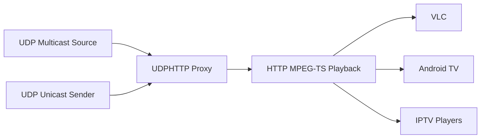

# UDPHTTP Proxy

UDPHTTP Proxy converts authorized IPv4 multicast or unicast **MPEG-TS over UDP** into HTTP streams for VLC, Android TV and other IPTV players. Multiple viewers share one receiver per configured source identity. An embedded React/TypeScript dashboard manages channels, health, imports, playlists and diagnostics; SQLite persists configuration and bounded operational events.

**Phase 4 / 0.4.0 development candidate.** Read [the exact validation report](docs/PHASE4_REPORT.md) before deployment. The user verified real TRACE URBAN multicast playback on Ubuntu before these changes. Phase 4 cross-builds, local synthetic tests and CI definitions do not certify every supported OS or production capacity. This work does not publish a stable release.

## 1. Overview

- Multicast/unicast UDP reception with explicit interfaces, source allowlists and client CIDRs.
- Bounded shared fan-out, slow-client isolation, automatic socket/interface recovery with jittered retry.
- Separate UDP datagram and MPEG-TS packet/continuity/synchronization observations.
- Channel metadata, transactional M3U import, sorted/filterable playlist export and opt-in restricted remote playlists.
- Local management, CSRF-protected writes, retained health/history/logs and safe network diagnostics.
- Linux systemd/Debian packaging and native Windows SCM implementation with separate acceptance gates.

RTP, upstream HTTP/HLS pulling, transcoding, FEC and browser codec validation are not implemented. Supported URL import patterns describe UDP sources, not generic HTTP video downloads.

## 2. Architecture



Management and playback use separate listeners. Receivers are shared across viewers and both playback ports; channel writes do not create duplicate source workers. See [architecture and concurrency invariants](docs/ARCHITECTURE.md).

## 3. Requirements and platform status

| Area | Requirement / status |
| --- | --- |
| Linux target | Ubuntu 22.04/24.04, Debian 12+, AMD64/ARM64; Phase 4 native acceptance tracked separately |
| Windows target | Windows 10/11 x64, Server 2019+; native service implemented, SCM acceptance required |
| Source builds | Go 1.26+ (CI 1.27), Node 24/npm 11+, Git, Python 3.10+ |
| Race tests | Supported GCC/CGO toolchain; production SQLite builds do not need CGO |
| Networking | Assigned IPv4 on selected adapters; multicast-capable input for multicast, routing/IGMP/firewall configured independently |
| Hardware | No measured minimum or capacity guarantee. Start planning around 2 CPU cores/2 GiB and adequate NIC throughput, then measure the actual workload. This is an estimate, not a tested sizing promise. |

Installed binaries embed the frontend and do not require Node or a CDN. Hardware multicast/decoder acceptance must be repeated on the deployment network. Windows ARM64 is not released. Native ARM64 runtime validation is distinct from a Linux ARM64 cross-build.

## 4. Quick start — Linux

Download an approved candidate's actual files and `SHA256SUMS-phase4`, verify them, then:

```sh
sha256sum --check --ignore-missing SHA256SUMS-phase4
sudo apt install './udphttp-proxy_0.4.0~dev_amd64.deb'
sudo systemctl enable --now udphttp-proxy
sudo systemctl status udphttp-proxy --no-pager
curl --fail http://127.0.0.1:8080/health
```

Open `http://127.0.0.1:8080` on the server or use an SSH tunnel. Configure UDP/HTTP interfaces and explicit source/client allowlists, add the first channel, then test its copied playback URL in VLC. Defaults intentionally permit no playback sources/clients. See [complete Linux installation](docs/INSTALL_LINUX.md).

## 5. Ubuntu 22.04/24.04 installation

This task creates artifacts locally, not a published tag. After an approved release supplies the named files, its download pattern is:

```sh
sudo apt update
sudo apt install -y curl ca-certificates
VERSION=0.4.0-dev
TAG=v0.4.0-dev # Replace with the approved tag that actually contains these artifacts.
BASE="https://github.com/afrazafey/UDP-to-HTTP/releases/download/$TAG"
curl --fail --location --output SHA256SUMS-phase4 "$BASE/SHA256SUMS-phase4"
curl --fail --location --output 'udphttp-proxy_0.4.0~dev_amd64.deb' "$BASE/udphttp-proxy_0.4.0~dev_amd64.deb"
sha256sum --check --ignore-missing SHA256SUMS-phase4
sudo apt install './udphttp-proxy_0.4.0~dev_amd64.deb'
sudo systemctl enable --now udphttp-proxy
```

Use the matching filename/version/tag together; do not assume the example tag already exists. Configuration: `/etc/udphttp-proxy/config.yaml`; data: `/var/lib/udphttp-proxy`; executable: `/usr/bin/udphttp-proxy`. The package uses a dedicated non-login account and journald. Administrator-owned conffiles are preserved across upgrades.

## 6. Debian 12+ installation

Use the same verified `.deb` installation and systemd commands as Ubuntu. Select `amd64` for `uname -m` → `x86_64`, `arm64` for `aarch64`. Inspect a package with `dpkg-deb --info`/`--contents` before installation. [Linux guide](docs/INSTALL_LINUX.md) covers tar bundles and non-package operation too.

## 7. Windows installation

Verify `udphttp-proxy_0.4.0-dev_windows_amd64.zip` against the SHA-256 manifest, extract it, then:

```powershell
.\udphttp-proxy.exe interfaces
.\udphttp-proxy.exe serve --config .\configs\config.example.yaml
```

Interactive stop is Ctrl+C. To install the native LocalService SCM registration, review and run in elevated PowerShell:

```powershell
.\scripts\install-windows.ps1 -Binary (Resolve-Path .\udphttp-proxy.exe).Path
$exe = Join-Path $env:ProgramFiles 'UDPHTTPProxy\udphttp-proxy.exe'
& $exe service start
& $exe service status
& $exe service stop
& $exe service restart
```

Config/data/logs live below `%ProgramData%\UDPHTTPProxy`. The service installer sets explicit ACLs, automatic startup and bounded JSON logging, and preserves an existing configuration. Service execution/control uses native Go/x/sys APIs, not a wrapper. **Implemented does not mean native SCM acceptance has passed here**; consult the report. See [Windows guide](docs/INSTALL_WINDOWS.md) for exact firewall, logging, service installation, upgrade and uninstall steps.

## 8. Building from source — Linux

```sh
git clone https://github.com/afrazafey/UDP-to-HTTP.git
cd UDP-to-HTTP
npm --prefix frontend ci
npm --prefix frontend run typecheck
npm --prefix frontend test
npm --prefix frontend run build
go fmt ./...
go vet ./...
go test ./...
go test -race ./...
python3 scripts/build-release.py --version 0.4.0-dev
dpkg-deb --info './build/udphttp-proxy_0.4.0~dev_amd64.deb'
```

`scripts/build-deb.sh amd64 VERSION BINARY` remains a wrapper around the portable Debian builder. Linux CI separately inspects, installs, upgrades, removes and purges packages. Set `SOURCE_DATE_EPOCH` for deterministic archive timestamps. Binaries link version/actual source SHA/build time; dirty checkouts are labeled. Source `go run` without release metadata explicitly says unlinked-source rather than inventing a build timestamp.

## 9. Building from source — Windows

```powershell
git clone https://github.com/afrazafey/UDP-to-HTTP.git
Set-Location UDP-to-HTTP
npm.cmd --prefix frontend ci
npm.cmd --prefix frontend run typecheck
npm.cmd --prefix frontend test
npm.cmd --prefix frontend run build
go fmt ./...
go vet ./...
go test ./...
go test -race ./...
python scripts/build-release.py --version 0.4.0-dev
& .\build\udphttp-proxy-windows-amd64.exe serve --config .\configs\config.example.yaml
```

Race tests need GCC/CGO. If Application Control blocks a generated executable, record the blocked test and use an approved CI host; do not disable policy. For Vite development, run the Go daemon separately and `cd frontend; npm.cmd run dev`; browse port 5173. Vite does not start the backend.

## 10. Network configuration

One user-verified deployment uses UDP `ens18 / 10.14.0.37` on `10.14.0.0/24` and HTTP `ens19 / 192.168.10.103` on `192.168.10.0/24`. TRACE URBAN is multicast group `239.1.1.61`, UDP port `1234`; playback is `http://192.168.10.103:7781/live/trace-urban.ts`, secondary listener 7782. These addresses are examples from one deployment and must be replaced elsewhere.

Select explicit local interfaces, authorize each multicast group/unicast sender and client subnet, and review multicast routing, IGMP snooping/querier and firewall policy. The application does not change host networking. [Network guide](docs/NETWORK_CONFIGURATION.md) includes the complete example and Linux/Windows commands. Advertising a playback hostname is independent of binding a socket; configure `playlist.advertised_host` before exporting URLs.

## 11. Adding and managing IPTV channels

Streams → Add stream accepts ID/name, source type/IP/port/interface, enabled/startup/idle and buffer settings. Add TRACE URBAN using the example only on its tested network. Backend validation checks source policy, reserved exclusions, actual interface capability, limits and source/bind conflicts. Startup is on demand by default; manual Start pins a receiver for the process, and Stop/Restart affect that receiver only.

Optional metadata: logo URL, TVG ID/name, group/category, sort order, description, preferred primary/secondary port. Search/filter/sort and group filtering are available. Bulk enable/disable/delete requires confirmation and uses atomic persistence. Duplicate pre-fills a new-channel draft and requires a unique source identity. Edits/import updates replace the affected receiver and disconnect its viewers; failures preserve prior data. Details show current health, bounded history, receiver/recovery events, clients and playback URL/M3U actions.

## 12. M3U import and export

Playlists & Import supports bounded local M3U/M3U8 files/paste, preview, selected/all-valid atomic commit, skip/update-existing confirmation and downloadable validation errors. Sources must already be allowed. The parser supports literal `udp://[@]IPv4:port` and exact legacy HTTP `/udp/multicast-IP:port`, never arbitrary HTTP streams or remote fetching. Export includes enabled channels, metadata/order/group filtering, primary/secondary/preferred URLs and individual entries.

Remote `/playlist.m3u` on playback ports is off by default and requires separate explicit playlist CIDRs plus the playback CIDRs. Management export remains local/protected. See [M3U guide](docs/M3U_IMPORT_EXPORT.md) for formats, bodies and limitations.

## 13. API and command reference

Management base: `http://127.0.0.1:8080`. GETs inherit loopback/Host/origin guards. Mutations also require GET `/api/v1/csrf` → `token`, `X-CSRF-Token`, exact JSON, bounded bodies and write-rate policy. No permissive CORS or native remote account/session is provided.

| Methods | Implemented management route | Purpose |
| --- | --- | --- |
| GET | `/health`, `/api/v1/status`, `/api/v1/interfaces`, `/api/v1/csrf` | Health/config/runtime/discovery/token |
| GET, POST | `/api/v1/streams` | List snapshots/create a channel |
| GET, PUT, DELETE | `/api/v1/streams/{id}` | Read/replace/delete |
| POST | `/api/v1/streams/{id}/start`, `/stop`, `/restart` | Receiver lifecycle |
| GET | `/api/v1/streams/{id}/status`, `/errors`, `/metrics` | Current health/errors/bounded history |
| POST | `/api/v1/streams/bulk` | Confirmed atomic enable/disable/delete |
| GET | `/api/v1/clients` | Actual connected peers/queues/bytes/duration |
| DELETE | `/api/v1/clients/{id}` | Disconnect a subscription |
| GET | `/api/v1/dashboard`, `/api/v1/metrics`, `/api/v1/system` | Operational summary/resources/history/security |
| GET, PUT | `/api/v1/settings` | Desired/active settings/revisions and confirmed save |
| POST | `/api/v1/settings/validate`, `/rollback` | Preview/confirmed accepted-state rollback |
| GET | `/api/v1/logs`, `/api/v1/logs/export` | Filtered bounded sanitized events/NDJSON |
| GET | `/api/v1/playlist/config`, `/api/v1/playlist.m3u` | Read-only advertising policy/M3U export |
| POST | `/api/v1/import/preview`, `/commit` | Bounded preview and confirmed atomic import |
| GET, POST | `/api/v1/diagnostics` | Current observations/fixed safe diagnostic actions |

Playback routes are GET `/live/{id}.ts`, `/udp/{multicast-IP}:{port}`, and explicitly enabled `/playlist.m3u`; playback listeners expose no management API. Group routes require an enabled unambiguous configured source.

Channel JSON uses the field names in `configs/config.example.yaml`/the Channel type: `id`, `name`, `source_type`, `source_address`, `source_port`, `interface`, `enabled`, optional startup/buffers/metadata. Defaults fill omitted startup/buffer fields. Bulk body: `{ "ids": ["trace-urban"], "action": "disable", "confirm": true }`. Import bodies are in the [M3U guide](docs/M3U_IMPORT_EXPORT.md). Diagnostics accept only `action` and `channel_id`, with actions interface/source/multicast_eligibility/route/listener_connectivity/playback_ports.

Settings PUT uses `{ "revision": CURRENT, "settings": COMPLETE_OBJECT_FROM_GET, "confirm": true }`. Validate uses the same settings; rollback requires revision/confirmation. YAML-only management/storage/recovery/playlist/log-format fields cannot be changed through this object. Policy/bind changes are staged; general/log-level/retention preferences apply live. Startup can roll back a failed playback bind while preserving management.

Error envelopes use `error`. Typical statuses: 400 invalid, 403 denied, 404 missing, 405 method, 409 conflict, 413 size, 415 content type, 429 limits, 500 persistence, 503 unavailable/no startup data. Logs support search/level/stream_id/RFC3339 since/until, limit/offset; export caps at 1,000. Metrics sample every 3s into bounded RAM (240 aggregate/120 per channel), not SQLite. Unsupported observations are null/unavailable.

Commands: `serve --config FILE`, `interfaces`, `version`, `config validate --config FILE`, `database backup --config FILE --output NEW_DB`, `database verify --input BACKUP`, `database restore --input BACKUP --output NEW_DB --confirm-offline`, and Windows `service install/start/stop/restart/status/uninstall`. Database commands are CLI-only; there is no arbitrary file, shell, scanner or service-control HTTP endpoint.

## 14. Production deployment

Use the platform's service manager, least privilege, private persistent storage, static addressing, scoped firewalls, verified backups and measured resource limits. Review recovery/metrics/log retention and degraded/offline states. Read [production deployment and release gates](docs/PRODUCTION_DEPLOYMENT.md) and [safe upgrade/restore](docs/UPGRADE.md). Do not rely on short loopback measurements as a production sizing or long-term reliability guarantee.

## 15. Nginx integration

Optional playback proxying can provide managed TLS/access controls but adds buffering, timeout and client identity concerns. Direct Go playback is preferable when those gateway features are unnecessary. Validate disabled stream buffering, long-lived playback timeouts and actual-peer allowlist behavior before deployment; Go sees the proxy address and never trusts forwarded client IPs. Public endpoints need TLS and independent authorization.

No new unvalidated playback server block is presented as production-ready; [deployment guidance](docs/PRODUCTION_DEPLOYMENT.md) describes target-host checks. Management should use SSH forwarding. Existing explicit trusted-proxy compatibility remains disabled by default and requires authentication, TLS and a documented exact-origin design before production use; never expose unauthenticated administration.

## 16. Troubleshooting

Start with `/health`, channel details and logs. [Troubleshooting](docs/TROUBLESHOOTING.md) covers missing multicast/wrong adapter, allowlist rejection, playback 403/404/503, malformed/no TS, occupied ports, Windows/Linux firewall, changing interfaces, IGMP, stalled sources, slow clients, DB locks, failed upgrades and Vite/backend connectivity, with exact commands for both OS families.

## 17. Upgrading

Back up/verify the existing DB before replacing binaries. Migrations are versioned and transactional; schema 4 preserves prior channels/settings and adds metadata defaults. Old binaries need their matching pre-upgrade snapshot for rollback. Do not delete/reset the database, decrement user_version, reseed production data or copy only a live WAL main file. See [UPGRADE.md](docs/UPGRADE.md).

## 18. Uninstalling

Linux remove stops the service and preserves configuration/state; purge removes packaged config but deliberately retains data/account. Windows stop + `service uninstall` removes SCM registration and preserves config/data/logs. Intentional data removal is separate and should follow a verified backup and path review. [Upgrade/uninstall guide](docs/UPGRADE.md) gives both workflows.

## 19. Security

Local management trusts local users, keeps strict peer/Host/origin/referrer/CSRF/size guards, and cannot bind remotely. Sources and playback peers remain explicitly restricted. Imports never authorize sources or fetch URLs; metadata and TS parsing are bounded. No arbitrary network scanning, shell execution, path upload or remote backup endpoint is added. Read [SECURITY.md](docs/SECURITY.md), especially backup privacy and trusted-proxy limitations.

## 20. License and contributing

**No repository license is currently declared.** Do not assume open-source redistribution rights or invent a license. Resolve this with the owner before publishing/distributing a stable release; dependencies retain their own licenses.

Contribute through a feature branch and reviewable PR; do not push to main or publish releases without approval. Preserve the dual-network shared-receiver behavior, avoid policy changes in imports, use migrations for state changes, add relevant unit/integration/platform tests, run the documented checks, and update docs against actual routes/commands. Native CI results, skipped environment tests, synthetic measurements and physical IPTV acceptance must be reported separately. See [the Phase 4 plan](docs/PHASE4_PLAN.md), [changelog](CHANGELOG.md) and [validation report](docs/PHASE4_REPORT.md).
