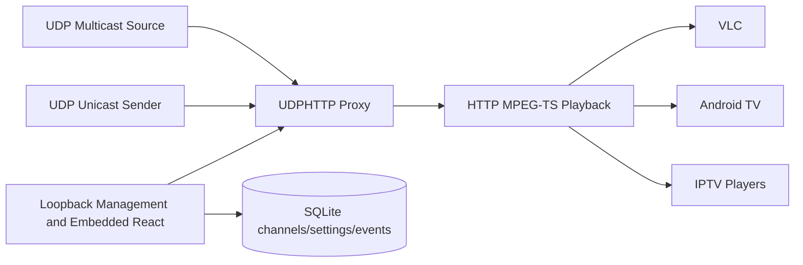

# Architecture

`internal/stream` owns source validation, explicit interface selection, UDP sockets, TS framing and shared bounded fan-out. The Linux packet/control-message path is retained. Windows uses IP_PKTINFO plus Go's WSARecvMsg-backed UDP read and verifies destination group and interface index. Windows receiver multicast loopback must be enabled separately because Winsock applies this option on reception; see [Microsoft's socket option semantics](https://learn.microsoft.com/en-us/windows/win32/winsock/ipproto-ip-socket-options).

The operation mutex serializes channel writes/lifecycle changes. The short-held manager mutex protects worker identities, receiver reservations, subscriptions, counters and bounded queues. A source reservation exists before socket opening; conflicting aliases are rejected. A worker owns opening, receiving, closing and retrying. Stop/shutdown cancels and joins the worker before replacing its entry. Multiple playback ports and viewers use the same receiver. Manual start pins a receiver; on-demand receivers retire after the last active viewer and configured idle delay. Slow clients are disconnected without stalling other consumers.

Phase 4 adds accepted-datagram timestamps separately from valid TS timestamps, application socket/join observations, operational health and recovery outcomes. Inactivity first reports waiting/degraded. Configurable silence recovery closes/reopens the socket and rejoins as appropriate with bounded exponential backoff and jitter. Socket/interface failures follow the same loop. Recovery succeeds only after framed TS resumes. Old `state` remains API-compatible; `health` adds healthy/waiting_for_source/recovering/degraded/offline/disabled. Disabled or exhausted recovery remains offline until a manual start/restart. An idle channel is not a failed UDP handshake.

The 188-byte framer keeps bounded pending bytes and PID continuity state. UDP datagrams, TS packets, sync losses, TEI/corrupt observations, continuity errors, explicit discontinuities and duplicates are distinct. These are observations, not exact network packet loss or codec validation. No RTP, transcoding, FEC or upstream HTTP fetching is implemented.

`internal/playlist` parses at most 1 MiB/1,000 entries of local UTF-8 input. HTTP URLs are converted only for the supported literal multicast `/udp/IPv4:port` pattern; no URL is requested. Metadata is bounded and validated before persistence/export. `Manager.Batch` checks candidate identities and limits, persists in one SQLite transaction, then replaces affected entries. A failed validation/commit leaves receivers and data unchanged. Updating an existing channel disconnects its viewers; this is disclosed before confirmation.

SQLite schema 4 extends the JSON channel records with defaults, retaining old records/settings and revisions. Migrations run inside a transaction; newer schemas fail closed. WAL and per-connection busy_timeout(5000) are enabled; one process-local DB connection serializes writes and bounds contention. Metrics stay in RAM (aggregate 240 samples, per-channel 120; 3-second sampling), never per-packet DB writes. Events have bounded queues, count/age retention and redaction. Backup uses parameterized VACUUM INTO plus integrity/schema/checksum verification; restore requires a new destination.

Management HTTP routes remain loopback-only with actual-peer/Host/Origin/Referer/fetch-metadata checks and CSRF+JSON+size/write-rate guards. Optional explicitly trusted same-host proxy support is retained, off by default; it is not native remote authentication. Playback and remote playlists have independent actual-peer CIDR policies and expose no administration routes. Forwarded identities never grant playback privileges. See [SECURITY.md](SECURITY.md).

The React application retains the existing components, themes and hash routes. API polling is bounded, non-overlapping and abortable. Forms keep failed drafts. Each visible import/bulk/export/diagnostic action calls an implemented endpoint. Metadata logos are not fetched by the server or rendered automatically in the dashboard.

Linux uses a hardened non-root systemd service and journald. Windows implements native SCM execution/control through x/sys/windows/svc, LocalService identity and bounded JSON log files. Compilation and handler tests do not establish successful SCM installation; that has a separate CI acceptance script.
